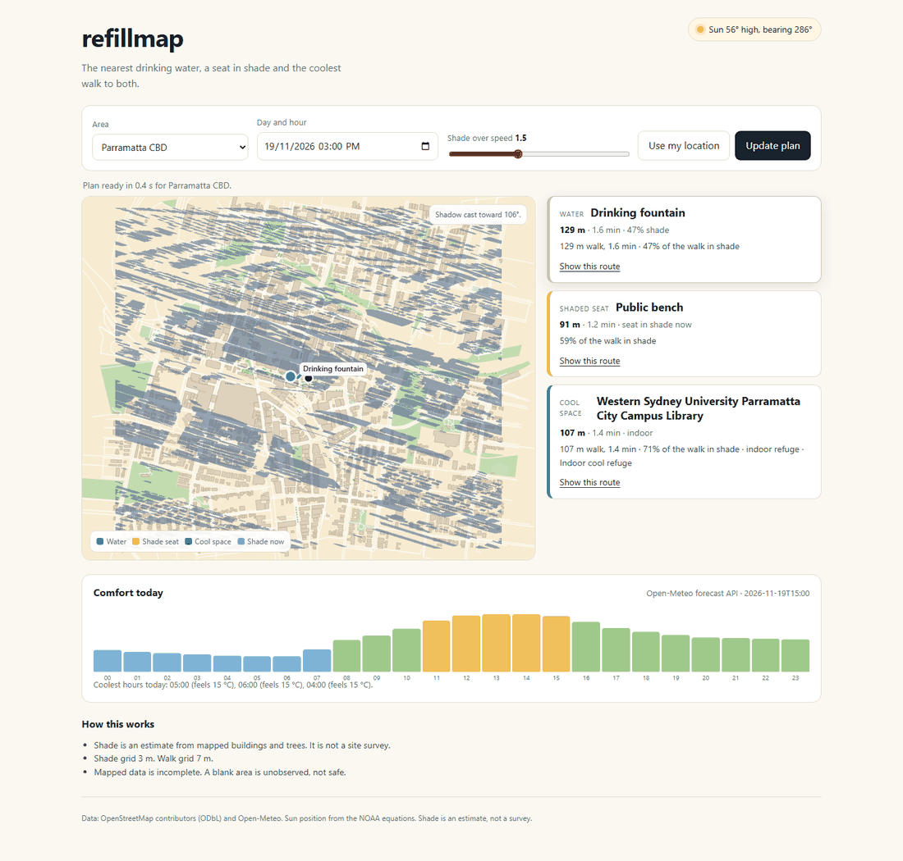
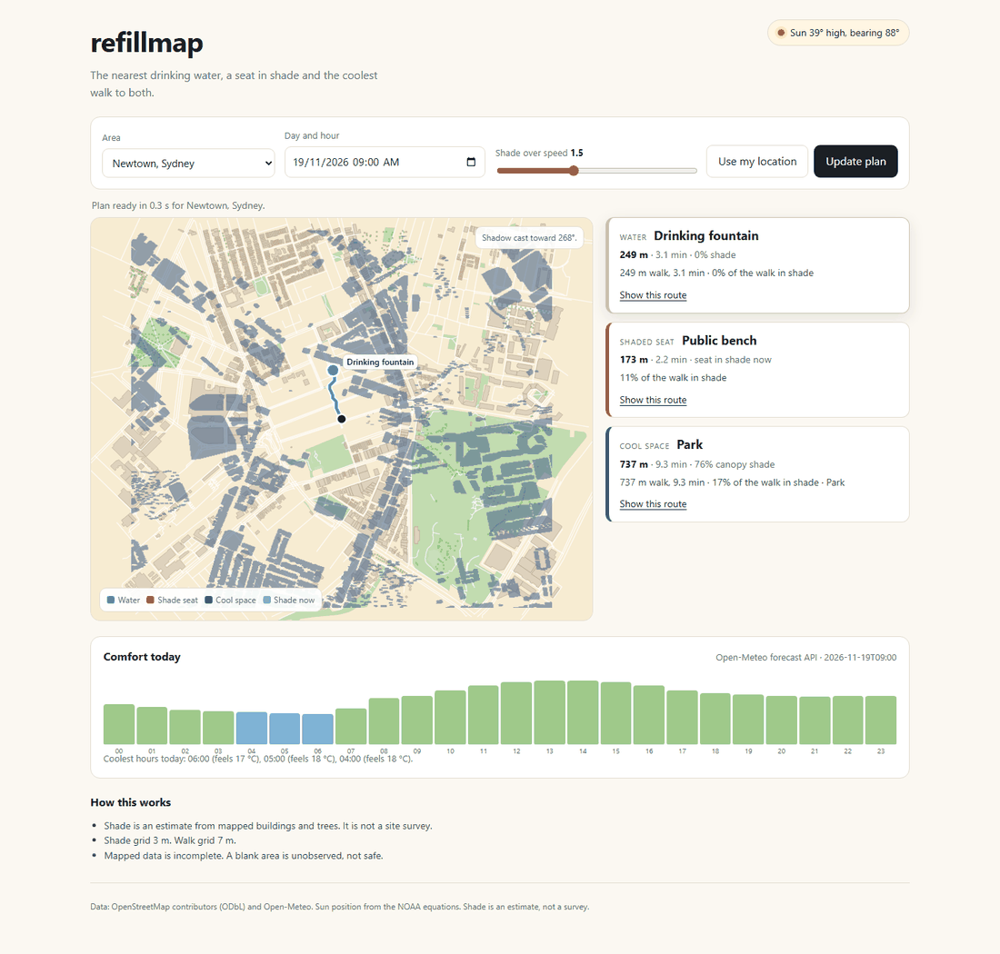

# refillmap

A heatwave survival map. It finds the nearest drinking fountain, a shaded seat and a cool public space. It routes you on the shadiest walk.


## Why this exists

On a 40 °C day the shortest walk is often the hottest one. Fountains, benches and libraries are mapped in OpenStreetMap. Shade is not. refillmap joins the two and answers one question: where do I go now?

## Features

- **One start point, three targets.** Drinking water, a seat in shade, and a cool space. Each target comes with its own route.
- **Shade-aware routing.** A sunlit cell costs more than a shaded cell. The slider sets the trade between shade and distance.
- **A real shadow model.** Building heights and tree crowns cast shadows for the chosen hour. Sun position uses the NOAA equations.
- **Self-contained map.** The page draws OpenStreetMap geometry on a canvas. No map tiles and no CDN, so it works offline.
- **Live area fetch.** Pick any location. The app pulls a fresh Overpass extract and caches it for 7 days.
- **Hourly comfort strip.** Open-Meteo gives apparent temperature and UV for the day. The strip names the coolest hours.

## Quick start

```bash
git clone https://github.com/fuleinist/refillmap
cd refillmap
python -m refillmap --port 8099
```

Open <http://127.0.0.1:8099>.

There are no runtime dependencies. Python 3.11 or newer with the standard library is enough.

Run the tests:

```bash
pip install -r requirements-dev.txt
python -m pytest
```

## Screenshots

**Parramatta CBD at 15:00.** The water route is 129 m and 47% shaded. The seat route is 91 m and 59% shaded.



**Newtown at 09:00.** Mapped shade is sparse in this area. The page shows that gap rather than hiding it.



## How the plan works

1. **Sun.** NOAA solar equations give elevation and azimuth for the area centre and the chosen hour.
2. **Shade mask at 3 m.** Each building footprint is swept along its shadow vector. Each tree crown is swept the same way. A building without a height gets 6 m, or 3.2 m per level.
3. **Walk grid at 7 m.** Cells within 7 m of a mapped path are walkable. Park and garden polygons are walkable. Building footprints are blocked.
4. **Route.** Dijkstra runs once from your start point. Each step costs `distance × (1 + shade_weight × exposure)`.
5. **Ranking.** Candidate places are scored by route cost with a bonus for shade. A private or restricted place gets a penalty.

## Data sources

- [OpenStreetMap](https://www.openstreetmap.org/) via the [Overpass API](https://overpass-api.de/). ODbL licence. Objects: fountains, benches, parks, trees, buildings, paths, libraries.
- [Open-Meteo](https://open-meteo.com/). Free, no key. Hourly temperature, apparent temperature, UV index, humidity.
- [NOAA solar position equations](https://gml.noaa.gov/grad/solcalc/calcdetails.html). Local computation.

The bundled snapshots in `data/` were fetched on 2026-11-19. To refresh one:

```bash
node scripts/fetch_snapshot.mjs data/snapshot-newtown.json "Newtown, Sydney" "-33.915,151.168,-33.900,151.188"
```

## API

| Endpoint | Purpose |
| --- | --- |
| `GET /api/health` | Liveness and area count |
| `GET /api/areas` | Bundled areas |
| `GET /api/area/{id}` | Map geometry for one area |
| `GET /api/plan` | Plan for an area, a time and a start point |

Example:

```bash
curl "http://127.0.0.1:8099/api/plan?area=newtown&at=2026-11-19T15:00&shade=1.5&weather=1"
```

`area=here&lat=…&lon=…` fetches a live 1.2 km box from Overpass. `weather=0` skips the weather call.

## Limits

- **Shade is an estimate.** It uses mapped objects only. In Newtown only 5 to 9 percent of walkable cells fall in mapped shade. Real street trees are often unmapped.
- **Coarse data.** A building without a height gets 6 m. A tree without a crown width gets a 3.5 m radius. The walk grid is 7 m.
- **No private land.** The router stays on mapped paths and parks.
- **Not medical advice.** Follow official heat and water warnings.
- **A blank area is unobserved, not safe.**

## License

Code is MIT. OpenStreetMap data is ODbL. Open-Meteo data is CC BY 4.0.